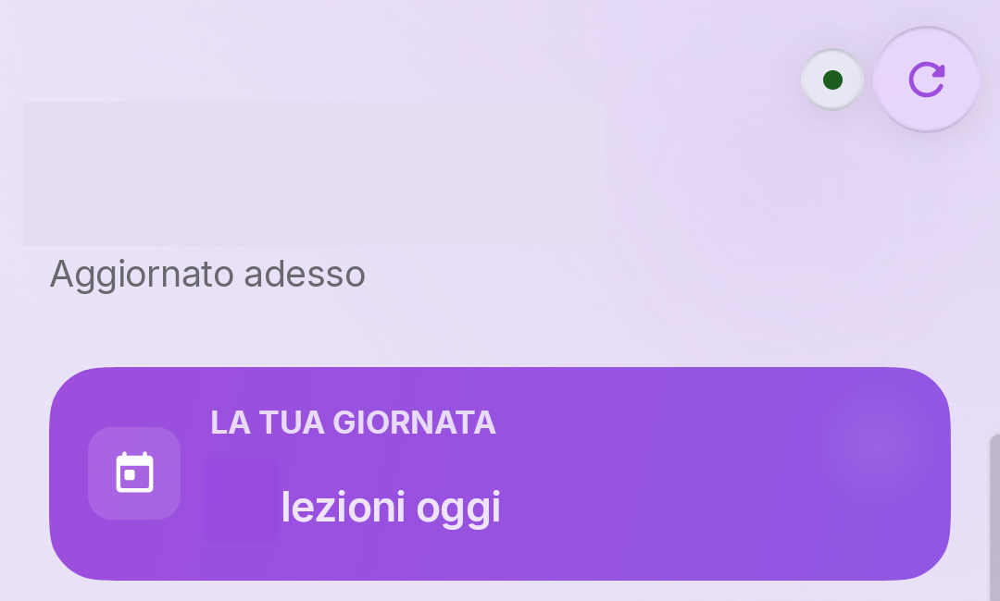

# Classeviva Expressive

### Il tuo registro, a colpo d’occhio.

Ritrova le informazioni della tua giornata scolastica in un’interfaccia Android pensata per essere semplice, chiara e piacevole da usare. Classeviva Expressive raccoglie voti, lezioni, agenda e comunicazioni in un unico posto.

## Tutta la giornata nella home

Apri l’app e dai subito un’occhiata alle lezioni del giorno, alla media, ai nuovi voti e alle comunicazioni da leggere. Da qui puoi raggiungere rapidamente le altre sezioni del registro.

## Quello che ti serve, quando ti serve

- **Voti** — consulta i risultati e tieni d’occhio l’andamento scolastico.
- **Agenda** — ritrova gli appuntamenti e gli impegni della scuola.
- **Lezioni e orario** — guarda le lezioni della giornata e le informazioni pubblicate sul registro.
- **Assenze** — consulta le informazioni sulle presenze.
- **Bacheca** — accedi alle comunicazioni della scuola.
- **Assistente e widget** — raggiungi informazioni e strumenti anche attraverso le funzioni dedicate dell’app.

## Un’interfaccia fatta per Android

Classeviva Expressive usa il design Fluid per rendere la consultazione del registro più moderna e intuitiva, con componenti e animazioni pensati per l’esperienza Android.

L’app conserva dati sul dispositivo e li sincronizza con il registro. Le informazioni e le operazioni disponibili possono variare a seconda della scuola e delle funzioni abilitate su Classeviva.

## Disponibilità

L’app richiede **Android 8.0 o successivo** e un account Classeviva per accedere ai dati del registro.

Lo screenshot mostrato è stato preso da un dispositivo reale e anonimizzato per proteggere la privacy di studenti e insegnanti.

## Licenza

Classeviva Expressive è un progetto open source distribuito sotto [GNU GPL v3.0](LICENSE).
